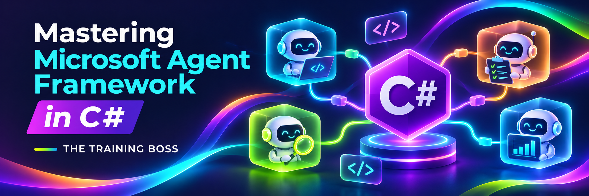

# Mastering Microsoft Agent Framework in C#

Source code and practical examples for the Udemy course **Mastering Microsoft Agent Framework in C#**, by **Lino Tadros | The Training Boss**.

## Dependency

The code is currently using Microsoft Agent Framework NuGet package version 1.27.0

## Overview

This repository accompanies the course with hands-on C# examples for building AI agents and agent-based applications using Microsoft Agent Framework.

The examples progress from connecting to language models and creating conversational agents to integrating tools, working with external knowledge, managing conversation state, and coordinating multiple agents through workflows. Use the code to follow the lessons, experiment with the concepts, and reinforce your understanding through practice.

## Topics Covered

The course examples explore:

- **Model integration:** Working with cloud-hosted and local models across multiple providers.
- **Agent fundamentals:** Configuring instructions, generating responses, streaming output, and maintaining conversations.
- **Tools and extensibility:** Function calling, Model Context Protocol (MCP), agent skills, and using agents as tools.
- **Structured and multimodal interactions:** Structured output, image understanding and generation, and PDF input.
- **Knowledge and retrieval:** Embeddings, vector stores, semantic search, and agentic retrieval-augmented generation (RAG).
- **Context and persistence:** Context providers, stored chat history, and semantic caching.
- **Application integration and diagnostics:** AG-UI, development interfaces, and OpenTelemetry.
- **Workflow orchestration:** Sequential and concurrent execution, handoffs, group conversations, and human participation.

## Who This Repository Is For

This repository is intended for C# and .NET developers who want practical experience building applications with AI agents. Familiarity with C#, asynchronous programming, NuGet packages, and basic API integration will help you get the most from the examples.

The accompanying [Udemy lessons](https://udemy.com/course/mastering-microsoft-agent-framework-in-c/) provide the explanations, demonstrations, and context behind the code.

## Prerequisites

Before running the examples, prepare the following:

- **.NET 10 SDK** for the projects targeting `net10.0`.
- A C# development environment, such as Visual Studio or Visual Studio Code with C# tooling.
- Git to clone the repository.
- Access to the model provider or local model runtime required by the example you choose.

Some examples also require additional services, model deployments, tools, or supporting resources. Configure these as demonstrated in the corresponding course lesson. You only need the dependencies for the examples you intend to run.

## Getting Started

### 1. Clone the repository

```bash
git clone https://github.com/TheTrainingBoss/Udemy-AgentFramework-csharp.git
cd Udemy-AgentFramework-csharp
```

### 2. Open the solution

Open `Udemy-AgentFramework-csharp.sln` at the repository root in your development environment, then select the example associated with your current lesson. All example projects are located under `src`.

### 3. Configure the selected example

Review its source code and configure the required credentials, endpoints, model names, deployment names, and service connections.

Configuration varies between examples. Several use .NET User Secrets, while others contain values that must be supplied or adjusted before execution. For examples that load User Secrets, set the exact configuration keys referenced in the code.

Keep API keys and other credentials out of version control. Use User Secrets or another appropriate configuration mechanism when adapting the examples.

### 4. Restore and run

From the repository root, enter the selected project's directory under `src`, then restore and run it. For example:

```bash
cd src/01-OpenAIDemo
dotnet restore
dotnet run
```

Alternatively, set the project as the startup project in your IDE and run it there. Examples involving a client, server, or external service may require additional startup steps described in the lesson.

## Repository Organization

The root-level `Udemy-AgentFramework-csharp.sln` references the course examples in numbered folders under `src`. Each example focuses on a specific concept, with supporting code and assets included where needed. Repository images remain in `media`.

Follow the course sequence for a guided learning path, or return to individual examples when reviewing a topic.

## Working with the Examples

For the best learning experience:

- Follow the corresponding lesson before modifying an example.
- Run the original code with your own configuration, then experiment with prompts, tools, models, and workflows.
- Use the package versions declared in the project files when reproducing the course demonstrations.
- Confirm that your selected model and provider support the features used by the example.

Model availability, service capabilities, and SDK APIs can change over time. Differences in package versions or provider configuration may require adjustments.

These examples are designed for instruction and experimentation. Before adapting them for production, review authentication, error handling, data protection, reliability, and operational requirements.

Cloud model and service usage may incur charges under your provider's pricing.

## Questions and Feedback

For questions about the lessons, use the Udemy course Q&A. To report a reproducible code issue, open an issue in this repository and include the relevant example, steps to reproduce, and error details. Remove credentials and sensitive information before sharing logs or configuration.

## License

The source code is licensed under the [MIT License](LICENSE).